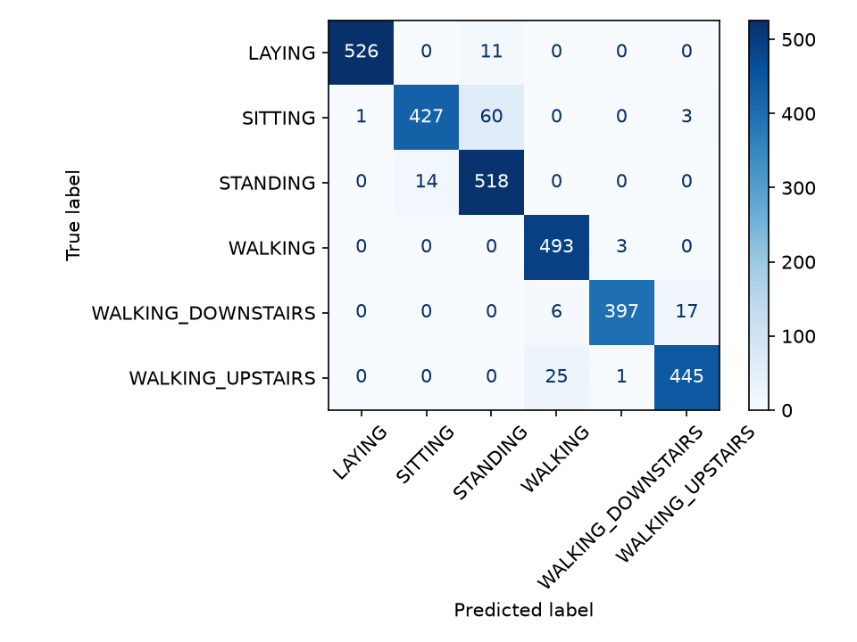
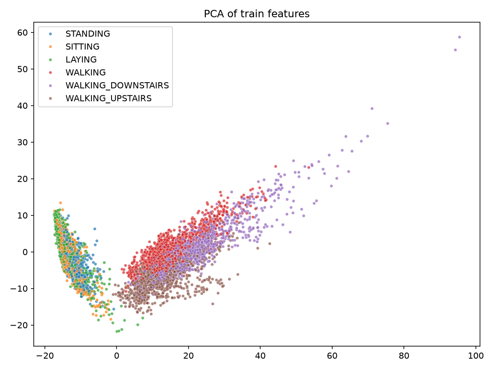
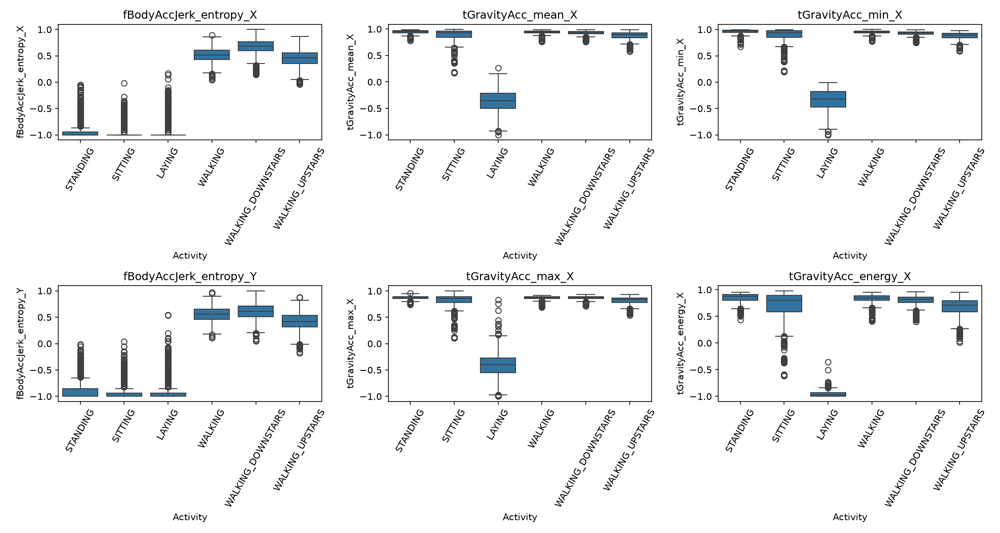

# Smart Fitness Tracker: Human Activity Recognition

Classifying 6 human activities from smartphone sensor data using machine learning,
evaluated on **subjects the model has never seen**.

## Key Result

| Metric                         | Value                       |
| ------------------------------ | --------------------------- |
| Macro-F1 (9 held-out subjects) | **0.952**                   |
| Accuracy                       | **95%**                     |
| Model                          | Logistic Regression (C=0.3) |

## Problem

Recognize what a person is doing (walking, walking upstairs, walking downstairs,
sitting, standing, laying) from accelerometer and gyroscope signals.

## Dataset

[UCI HAR](https://archive.ics.uci.edu/dataset/240/human+activity+recognition+using+smartphones):
30 volunteers, waist-mounted smartphone, 561 engineered features per window (2.56 s, 50 Hz).
Train: 7,352 samples (21 subjects). Test: 2,947 samples (9 subjects).

## Methodology

- **Subject-wise split:** no subject appears in both train and test, so results
  reflect generalization to new people.
- **Data audit:** no missing values or duplicates; classes balanced (ratio ~1.4).
- **Outliers:** analyzed with IQR (global and within-class) and Isolation Forest.
  Global IQR flagged walking and lying samples only because static activities dominate;
  within-class outliers were 3.45%. Features are bounded in [-1, 1]. Outliers were kept.
- **No leakage:** scaling is done inside a Pipeline, fitted on training folds only.
- **Model selection:** subject-wise 5-fold CV (GroupKFold) on train only.
  Test set used once.

## Model Comparison (CV macro-F1)

| Model               | Before tuning | After tuning |
| ------------------- | ------------- | ------------ |
| Logistic Regression | 0.934         | 0.934        |
| SVM (RBF)           | 0.930         | 0.932        |
| Random Forest       | 0.917         | n/a          |

Tuning changed results by less than 0.3 points, so the simplest model was chosen.

## Test Results



| Activity           | F1   |
| ------------------ | ---- |
| LAYING             | 0.99 |
| WALKING            | 0.97 |
| WALKING_DOWNSTAIRS | 0.97 |
| WALKING_UPSTAIRS   | 0.95 |
| SITTING            | 0.92 |
| STANDING           | 0.92 |

**Error analysis:** most errors are SITTING predicted as STANDING (60 samples).
Both are near-static postures that differ only in subtle torso tilt.
Walking variants are also confused occasionally.

## Exploratory Analysis




## Run It

```bash
git clone https://github.com/mohammedseghiralaa/fitness-tracker-ml.git
cd fitness-tracker-ml
python -m venv .venv
.venv\Scripts\activate
pip install -r requirements.txt

python -m fitness_tracker.clean
python -m fitness_tracker.eda
python -m fitness_tracker.tune
python -m fitness_tracker.final_test
```

Place `train.csv` and `test.csv` in `data/raw/` (not included in the repo).

## Project Structure

```
fitness_tracker/   code (load, clean, eda, tune, final_test)
data/              raw and processed data (git-ignored)
models/            saved models
reports/figures/   plots
```

## Next Steps

- 1D-CNN on raw sensor signals
- FastAPI + Streamlit demo

## License

MIT
